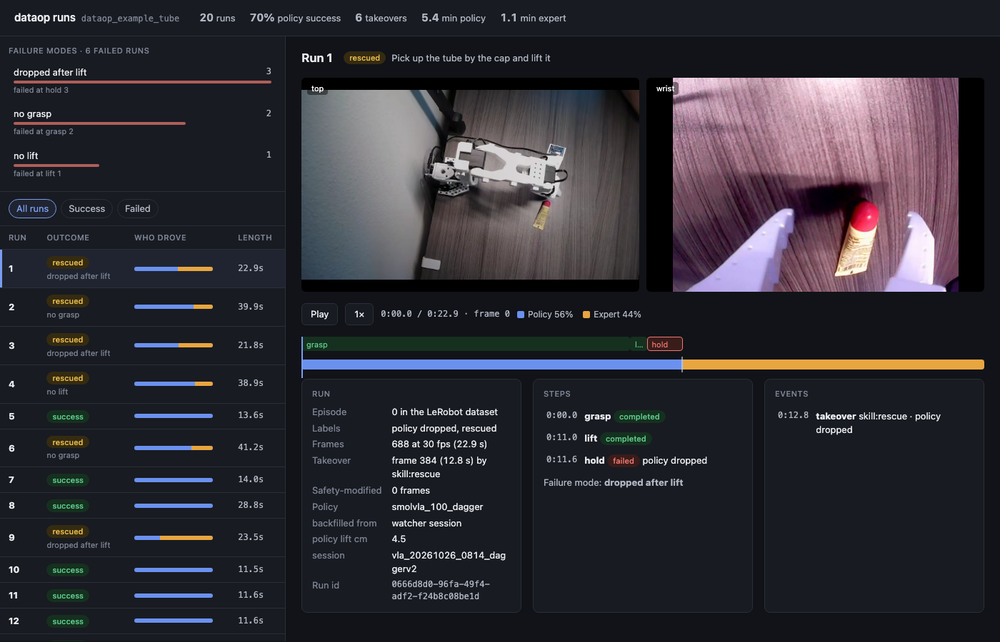

# dataop-logger

Record what post-training needs, next to a normal [LeRobot](https://github.com/huggingface/lerobot) dataset.

LeRobot saves what the robot did. To build DAgger, residual-network or RL datasets from real deployment runs you also need, for every frame:

- what the **base policy** proposed (even while a human or rescue skill was driving),
- what the **expert** did or would have done,
- the action **actually sent**, and **who was in control**,
- timing, an optional **reward**, and **how the run ended**.

dataop-logger records all of that in a small sidecar folder. Your dataset stays a plain LeRobot dataset that loads and trains anywhere.

## Install

```bash
pip install "git+https://github.com/Helloace-Labs/dataop-logger.git"
```

Requires Python 3.10+ and `lerobot` 0.6.x (tested with 0.6.2). PyTorch is only needed for the reader.

## Set it up with your coding agent

Give Claude Code, Codex, Cursor or any coding agent this prompt from inside your robot project:

```text
Read https://raw.githubusercontent.com/Helloace-Labs/dataop-logger/main/skills/dataop-logger/SKILL.md
and add dataop-logger to my recording loop. Validate it when done.
```

The agent checks your LeRobot version, finds your recording loop, wires in the logger and runs `dataop-logger validate`. Claude Code users can also install it as a skill by copying `skills/dataop-logger/` into `~/.claude/skills/`.

## Quick start

Three changes to an existing LeRobot recording loop: describe your action once, record through `run.add_frame`, and let the `run` block save the episode.

```python
import time
from dataop_logger import ActionSchema, EnvInfo, PolicyInfo, RunLogger

schema = ActionSchema(
    names=("shoulder_pan", "shoulder_lift", "elbow_flex", "wrist_flex", "wrist_roll", "gripper"),
    units=("deg",) * 5 + ("pct",),
    space="joint_position",          # or joint_velocity, ee_delta, ee_pose, custom:<name>
    rate_hz=30,
)

with RunLogger(dataset, schema) as log:              # dataset: a LeRobotDataset opened for writing
    with log.run(task="pick up the tube",
                 policy=PolicyInfo(family="smolvla", source="me/smolvla_tube"),
                 env=EnvInfo(robot_id="arm-1", extras={"light": "daylight"})) as run:
        for step in range(max_steps):
            obs = robot.get_observation()
            t_obs = time.monotonic_ns()
            action = policy.select_action(obs)        # in robot command space, after postprocessing
            robot.send_action(action)
            t_sent = time.monotonic_ns()
            run.add_frame(frame, sent_action=action, base_action=action, control_mode="base",
                          inference_id=step, chunk_offset=0, obs_ns=t_obs, sent_ns=t_sent)
        run.end(termination_reason="success")         # success, failure, timeout, operator_abort, system_error
```

`run.add_frame` replaces `dataset.add_frame`, and leaving the `run` block replaces `dataset.save_episode`. Do not call those two LeRobot methods yourself while a run is open; the logger checks and refuses to save if the buffer was changed behind its back.

## Recording takeovers

When a person or a scripted skill takes over, keep running the base policy in shadow if you can, and log both actions:

```python
run.add_frame(frame,
              sent_action=expert_action,      # what the motors got
              expert_action=expert_action,    # the expert's label
              base_action=shadow_action,      # what the policy would have done (optional, but needed for residuals)
              inference_id=k, chunk_offset=j, # only when base_action is given
              control_mode="expert", expert_source="human",   # or "skill:rescue_v3"
              obs_ns=t_obs, sent_ns=t_sent)
```

| `control_mode` | Meaning | Required |
| --- | --- | --- |
| `base` | The policy drove | `base_action` |
| `expert` | A human or skill drove | `expert_action`, `expert_source` |
| `blend` | A mix of both | `base_action`, `expert_action`, `expert_source`, `blend_weight` in [0, 1] |
| `none` | Nobody (idle, resetting) | nothing |

You can also log an expert label without executing it (`control_mode="base"` with an `expert_action` and `expert_source`), which is what DAgger queries look like.

Typed events mark moments worth finding later:

```python
run.event("takeover", source="human", reason="tube slipping")
```

## Rewards for RL

Pass `reward=` on `add_frame`, or, if your reward arrives one loop late, attach it to the previous tick:

```python
run.complete_transition(reward=r, terminated=False, truncated=False)
```

Row `t` is `(observation_t, sent_action_t, reward_t)`. `run.end()` sets the final tick's `terminated` (success, failure) or `truncated` (timeout, operator_abort, system_error) flag and rejects contradictions. A run with a reward on every tick is marked `rl_ready`.

## Action chunks (optional)

For chunking policies such as ACT or SmolVLA, log each inference's full chunk:

```python
with log.run(task="...", log_predictions=True) as run:
    run.predictions(inference_id=k, action_chunk=chunk, obs_frame_index=i,
                    infer_start_ns=t0, infer_end_ns=t1)
```

## Re-recording and errors

- `run.discard()` drops the current episode, both LeRobot's buffer and the sidecar.
- An exception inside the `run` block discards the episode. Leaving the block without `run.end()` is an error, never a silent save.
- If `save_episode` fails, the run is kept for repair and the logger refuses further runs until you reopen the dataset.

## Command line

```bash
dataop-logger validate <dataset_root>            # nonzero exit on any problem; --json for a report
dataop-logger validate <dataset_root> --repair   # commit runs that match a saved episode, quarantine the rest
dataop-logger inspect  <dataset_root>            # runs, outcomes, takeovers, minutes per control mode
dataop-logger remap <old_root> <new_root> --repo-id ID --revision REV   # after filtering or renumbering episodes
```

`validate` checks that every run matches its LeRobot episode frame for frame and byte for byte, that the episode was fully saved (metadata and video files present), that the sidecar files match their recorded checksums, and every rule above.

## Viewer

```bash
dataop-logger view <dataset_root>      # opens http://127.0.0.1:8765/dataop/view/
```

A local, read-only page: every run with its outcome and a strip showing who drove each frame, then the selected run's camera videos in sync with a control-mode timeline. Click the timeline or an event to jump to that moment. Nothing leaves your machine. `--build-only` writes `dataop/view/index.html` without starting a server.



## Training with the extra fields

```python
from lerobot.datasets.lerobot_dataset import LeRobotDataset
from dataop_logger.reader import DataopDataset

ds = DataopDataset(LeRobotDataset("me/tube_runs", root="data/tube_runs"), missing="error")
item = ds[0]
item["action"]                        # the usual LeRobot fields are unchanged
item["dataop.dagger_label"], item["dataop.dagger_mask"]                        # expert action
item["dataop.expert_residual"], item["dataop.expert_residual_mask"]            # expert - base
item["dataop.executed_residual"], item["dataop.executed_residual_mask"]        # sent - base, safety-modified ticks masked
```

Every per-tick field is also available as `item["dataop.<field>"]`. `missing="exclude"` skips episodes recorded without the logger, and `missing="mask"` keeps them with all masks false. Episode-filtered LeRobot views are supported and keep LeRobot's order.

## What gets written

```
<dataset_root>/dataop/
  runs/<run_id>/manifest.json       # outcome, takeovers, events, policy, environment, action schema, checksums
  runs/<run_id>/ticks.parquet       # one row per frame
  runs/<run_id>/predictions.parquet # only with log_predictions=True
  index.jsonl                       # summary of committed runs
  quarantine/                       # runs repair could not match, kept for inspection
```

The full field list and design are in [SPEC.md](SPEC.md).

## Limits of v0.1

- One writer process per dataset, local filesystem only.
- One task per run.
- `sent_action` is the final command after your safety filters; the logger does not record a separate pre-filter command or the actuator's measured action.
- One observation timestamp per frame, not per camera.
- Validation checks video files exist; it does not decode them.

## How this was built

The design and code went through five rounds of review between Claude (Anthropic) and Codex (OpenAI). Every review and the decision taken on each finding are in [reviews/](reviews/).

## License

Apache 2.0
