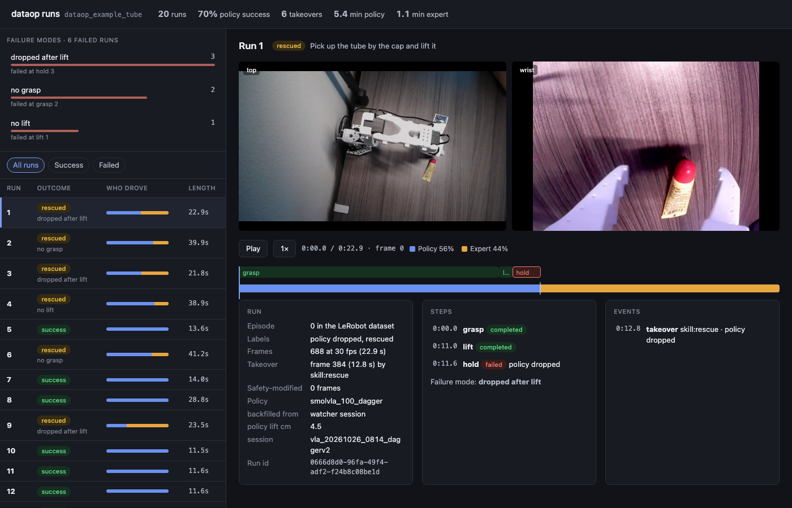

# Aftershock

The post-training data workspace for robotics.

`aftershock-logger` is Aftershock's open-source logger and local viewer. It was called `dataop-logger` before, and
the old names keep working: see [Renamed from dataop-logger](#renamed-from-dataop-logger).

In Aftershock, the logger is how runs get in. Aftershock's station app uses it when Aftershock drives the robot (Drive mode), and you add it to your own control loop when your software drives (Watch mode). Review, training sets and results all read what it records.

Record what post-training needs, next to a normal [LeRobot](https://github.com/huggingface/lerobot) dataset.

LeRobot saves what the robot did. To build DAgger, residual-network or RL datasets from real deployment runs you also need, for every frame:

- what the **base policy** proposed (even while a human or rescue skill was driving),
- what the **expert** did or would have done,
- the action **actually sent**, and **who was in control**,
- timing, an optional **reward**, and **how the run ended**.

aftershock-logger records all of that in a small sidecar folder. Your dataset stays a plain LeRobot dataset that loads and trains anywhere.

## Install

```bash
pip install "git+https://github.com/Helloace-Labs/dataop-logger.git"
```

Requires Python 3.10+ and `lerobot` 0.6.x (tested with 0.6.2). PyTorch is only needed for the reader.

### Renamed from dataop-logger

The package is now `aftershock-logger` and the Python package is `aftershock_logger`. Nothing that worked before breaks:

- `import dataop_logger` and `from dataop_logger.reader import DataopDataset` still work. They give the very same
  modules and classes as `aftershock_logger`, so old scripts, pickles and type checks keep working. New code should
  import `aftershock_logger`.
- Both commands are installed: `aftershock-logger` and the old `dataop-logger`. They are the same program.
  `python -m dataop_logger.cli` also still works.
- The sidecar folder keeps its name, `dataop/`, and so do the reader's `dataop.*` columns, `dataop_export.json` and
  the manifest's `env.software.dataop_logger` key. The logger reads and writes these exactly as before, so datasets
  recorded with dataop-logger load, validate and export unchanged.
- If an older `dataop-logger` install is in the same environment, run `pip uninstall dataop-logger` before installing,
  since both own the `dataop_logger` folder.

## Set it up with your coding agent

Give Claude Code, Codex, Cursor or any coding agent this prompt from inside your robot project:

```text
Read https://raw.githubusercontent.com/Helloace-Labs/dataop-logger/main/skills/aftershock-logger/SKILL.md
and add aftershock-logger to my recording loop. Validate it when done.
```

The agent checks your LeRobot version, finds your recording loop, wires in the logger and runs `aftershock-logger validate`. Claude Code users can also install it as a skill by copying `skills/aftershock-logger/` into `~/.claude/skills/`.

## Quick start

Three changes to an existing LeRobot recording loop: describe your action once, record through `run.add_frame`, and let the `run` block save the episode.

```python
import time
from aftershock_logger import ActionSchema, EnvInfo, PolicyInfo, RunLogger

schema = ActionSchema(
    names=("shoulder_pan", "shoulder_lift", "elbow_flex", "wrist_flex", "wrist_roll", "gripper"),
    units=("deg",) * 5 + ("pct",),
    space="joint_position",          # or joint_velocity, ee_delta, ee_pose, custom:<name>
    rate_hz=30,
)

with RunLogger(dataset, schema) as log:              # dataset: a LeRobotDataset opened for writing
    with log.run(task="pick up the tube",
                 policy=PolicyInfo(family="smolvla", source="me/smolvla_tube"),
                 env=EnvInfo(robot_id="arm-1", extras={"light": "daylight"})) as run:
        for step in range(max_steps):
            obs = robot.get_observation()
            t_obs = time.monotonic_ns()
            action = policy.select_action(obs)        # in robot command space, after postprocessing
            robot.send_action(action)
            t_sent = time.monotonic_ns()
            run.add_frame(frame, sent_action=action, base_action=action, control_mode="base",
                          inference_id=step, chunk_offset=0, obs_ns=t_obs, sent_ns=t_sent)
        run.end(termination_reason="success")         # success, failure, timeout, operator_abort, system_error
```

`run.add_frame` replaces `dataset.add_frame`, and leaving the `run` block replaces `dataset.save_episode`. Do not call those two LeRobot methods yourself while a run is open; the logger checks and refuses to save if the buffer was changed behind its back.

## Recording takeovers

When a person or a scripted skill takes over, keep running the base policy in shadow if you can, and log both actions:

```python
run.add_frame(frame,
              sent_action=expert_action,      # what the motors got
              expert_action=expert_action,    # the expert's label
              base_action=shadow_action,      # what the policy would have done (optional, but needed for residuals)
              inference_id=k, chunk_offset=j, # only when base_action is given
              control_mode="expert", expert_source="human",   # or "skill:rescue_v3"
              obs_ns=t_obs, sent_ns=t_sent)
```

| `control_mode` | Meaning | Required |
| --- | --- | --- |
| `base` | The policy drove | `base_action` |
| `expert` | A human or skill drove | `expert_action`, `expert_source` |
| `blend` | A mix of both | `base_action`, `expert_action`, `expert_source`, `blend_weight` in [0, 1] |
| `none` | Nobody (idle, resetting) | nothing |

You can also log an expert label without executing it (`control_mode="base"` with an `expert_action` and `expert_source`), which is what DAgger queries look like.

Typed events mark moments worth finding later:

```python
run.event("takeover", source="human", reason="tube slipping")
```

## Task steps and failure modes

Pass-fail hides why a run failed. Mark the task's steps as they happen, and name the failure when the run ends:

```python
run.subgoal("grasp", "started")          # just before the step's first frame
...
run.subgoal("grasp", "completed")        # just after its last frame; the next step starts here
run.subgoal("lift", "failed", reason="tube slipped")
run.end(termination_reason="failure", failure_mode="dropped_during_lift")
```

The manifest gets a `subgoals` list of frame spans with their status. `inspect` counts failure modes and failed steps across runs, and the viewer groups failed runs by failure mode and draws each run's steps above its timeline. Steps can come from anything your stack already knows: a success detector, gripper and height thresholds, or a person's label.

## Task, planner and prompt (optional)

When your stack knows them, record which task revision a run used, which planner picked its subtasks, and what the policy was told on each frame:

```python
from aftershock_logger import PlannerInfo

log = RunLogger(dataset, schema, planner=PlannerInfo(name="Rules", id="rules-v3"))   # None: no planner runs
with log.run(task=task, policy=policy, task_id="tube-pick", task_rev=3) as run:
    run.add_frame(frame, ..., prompt="grasp the cap", prompt_rev=2, subtask_cmd="st_02", control_gen=1)
```

`prompt` is the text the policy received, `prompt_rev` counts prompt changes, `subtask_cmd` is the subtask id the planner commanded, and `control_gen` is your loop's command generation counter. Leave out what you do not know: it is stored as `unknown`, which is different from `None` (known to be none, for example no planner ran). The same holds for `policy`: leave it out and it is `unknown`; pass `policy=None` only for runs no policy drove, such as teleop demos. On disk the two counters are int64 columns with -1 for unknown. Runs written before these fields existed read as `unknown` too.

## Rewards for RL

Pass `reward=` on `add_frame`, or, if your reward arrives one loop late, attach it to the previous tick:

```python
run.complete_transition(reward=r, terminated=False, truncated=False)
```

Row `t` is `(observation_t, sent_action_t, reward_t)`. `run.end()` sets the final tick's `terminated` (success, failure) or `truncated` (timeout, operator_abort, system_error) flag and rejects contradictions. A run with a reward on every tick is marked `rl_ready`.

## Action chunks (optional)

For chunking policies such as ACT or SmolVLA, log each inference's full chunk:

```python
with log.run(task="...", log_predictions=True) as run:
    run.predictions(inference_id=k, action_chunk=chunk, obs_frame_index=i,
                    infer_start_ns=t0, infer_end_ns=t1)
```

## Re-recording and errors

- `run.discard()` drops the current episode, both LeRobot's buffer and the sidecar.
- An exception inside the `run` block discards the episode. Leaving the block without `run.end()` is an error, never a silent save.
- If `save_episode` fails, the run is kept for repair and the logger refuses further runs until you reopen the dataset.

## Recording from a control loop: the bounded queue

On a robot, record through `run.queue()` so the loop never waits for the disk:

```python
from aftershock_logger import ControlledStop

try:
    with log.run(task=TASK, policy=policy) as run:
        q = run.queue()                  # holds at most 2 s of frames
        try:
            for each tick:
                q.put(frame, sent_action=a, base_action=a, control_mode="base",
                      inference_id=k, chunk_offset=j, obs_ns=t_obs, sent_ns=t_sent)
            run.end(termination_reason="success")
        except ControlledStop:
            hold_the_robot()             # first, while still inside the run block
            raise                        # leaving the block writes the frames to quarantine
except ControlledStop as stop:
    print(stop)                          # the run ended as system_error; end the session as a fault
    if stop.quarantine_error:            # the message says where the frames are, or that they were NOT written yet
        ...                              # free space, then run.retry_quarantine()
```

If the queue fills or a write fails (a full disk, for example), `put()` raises `ControlledStop`. Hold the robot inside the run block, as above, then let the stop leave the block. Do not hold it only in a handler outside the block: leaving the block first waits for the frame writer (up to `stop_timeout`, 10 s by default) and writes the quarantine to disk, and the robot would keep its last command all that time. Every frame the logger accepted is written to `dataop/quarantine/<run_id>/` with the reason, and the run is never saved as a complete episode. If even that write fails, the stop says the frames were not written and they stay in memory: call `run.retry_quarantine()` once there is space. Closing the `RunLogger` retries too and, if the disk is still full, writes them to a spill folder and says where; the stop's message is updated too. On a robot, pass `RunLogger(..., spill_dir=...)` with a persistent folder on a different disk from the dataset: the default (`~/.local/share/aftershock-logger/spill`) survives reboots but is usually on the same disk that just filled up. `aftershock-logger validate --repair` checks quarantined runs and keeps them. Details are in [SPEC.md](SPEC.md).

## Live status for a station (Watch)

When a station app watches your recording (Aftershock's Watch mode), turn on the live tap. It writes a small live status of the run in progress to `dataop/live/` for a process on the same computer to read, and never slows or stops your loop:

```python
log = RunLogger(dataset, action_schema=schema, live=True)
with log.run(task=TASK, policy=policy) as run:
    q = run.queue()
    for each tick:
        q.put(frame, sent_action=a, base_action=a, control_mode="base", inference_id=k, chunk_offset=j,
              obs_ns=t_obs, sent_ns=t_sent,
              camera_ns={"top": t_top, "wrist": t_wrist})   # optional: each camera's capture time, for dropouts
    run.end(termination_reason="success")
```

- `dataop/live/status.json` is the current run (frame, who drives, prompt and subtask when you pass them, the latest `observation.state` with its names, the action schema), the last run and its outcome, and any controlled stop. It is rewritten at least once a second and at once on each change.
- `dataop/live/events.jsonl` has one numbered record per change: run start, every control mode change (a takeover of a few frames included), run end, a controlled stop, and record check results while recording (a camera that stopped sending new frames, when you pass `camera_ns`; a command outside the action schema's bounds, when it declares them).
- Camera previews (`dataop/live/preview/<camera>.jpg`, at most 320 px wide) are written only while the station asks for them through `dataop/live/preview.want`. Without a request no image is copied or encoded.
- If the tap cannot write (a read only folder, a missing encoder), it warns once, writes `dataop/live/error.json` and stays off until the next run. Your recording is the same byte for byte with the tap on, off or failed.
- `dataop/live/` is not part of the dataset or the sidecar: `validate`, `import`, `export` and uploads ignore it. Details are in [SPEC.md](SPEC.md), Live tap.

## Command line

```bash
aftershock-logger validate <dataset_root>            # nonzero exit on any problem; --json for a report
aftershock-logger validate <dataset_root> --repair   # commit runs that match a saved episode, quarantine the rest
aftershock-logger inspect  <dataset_root>            # runs, outcomes, takeovers, minutes per control mode
aftershock-logger remap <old_root> <new_root> --repo-id ID --revision REV   # after filtering or renumbering episodes
```

`validate` checks that every run matches its LeRobot episode frame for frame and byte for byte, that the episode was fully saved (metadata and video files present), that the sidecar files match their recorded checksums, and every rule above.

## Viewer

```bash
aftershock-logger view <dataset_root>      # opens http://127.0.0.1:8765/dataop/view/
```

A local page: every run with its outcome and a strip showing who drove each frame, then the selected run's camera videos in sync with a control-mode timeline. Click the timeline or an event to jump to that moment. Nothing leaves your machine.

The recorded data is never changed. Labels and cuts you make in the page are saved to a separate file next to each run (see below). Use `--read-only` for a page that cannot save anything, and `--build-only` to write `dataop/view/index.html` without starting a server.

A dataset whose reviews are synced from Aftershock (it has `dataop/sync.json`, written by the Aftershock station app) always opens read only: its reviews are changed in Aftershock and synced back, and every local review change, from the page or a script, is refused.



When runs carry `failure_mode` and `subgoals`, the run list opens with failed runs grouped by failure mode. Click a group to filter the list.

## Editing runs

The run view has three rows: task segments, drive mode (who drove), and the playhead row. Only the playhead row moves the playhead. Press **Edit** (or E) to correct the first two:

- **Task segments:** drag the handles on the segment lane. The line between two segments moves both sides together, and an outer start or end can move up to its neighbour.
- **Drive mode:** drag the handle where control switches (for example policy to rescue) to where the switch really happened.
- **Policy fails:** drag the red marker to where the policy actually started to fail. The two seconds before it are underlined.

While you drag, tables below the bar update live. They show each segment's and drive span's start, end, length and frames, the change from the recording, and when the policy fails. Cut frames stay in the recording but are left out of training; click a cut to undo it.

**Lists (the dataset's schema).** Each dataset keeps two agreed lists in `dataop/lists.json`: **failure types** and **task segments**. People and agents pick from them, so counts stay comparable across runs. The first time the lists are read, they are seeded from the names the dataset already uses. In the viewer you never see the lists as such; in Edit you use and grow them in place:
- click a task segment to change its type, add a new type, split it at the playhead or remove it;
- click an empty part of the segment lane to add a segment there;
- pick or add a failure type next to the failure row.

The × on a type removes it from the dataset when no run uses it. A rename (from the command line) keeps the old name as an alias, so recorded data still matches.

Agents use the same lists:

```bash
aftershock-logger lists <dataset_root>                                       # JSON
aftershock-logger lists <dataset_root> add failure_types collision --description "hit something"
aftershock-logger lists <dataset_root> rename task_segments lift raise
```

**Agents fill in the same schema.** `aftershock-logger runs <dataset_root>` returns each run's segments, drive mode, failure moment and type, and video files as JSON. An agent that watched the video writes its reading back with `aftershock-logger annotate <dataset_root> <run_id> --segments ... --failure-at ... --failure-type ... --takeover-at ... --by my-agent`. Names must come from the lists. Each value is a proposal that shows who set it; a person accepts, changes or rejects it in the viewer.

**AI feature: find idle frames.** In Edit, **✦ Find idle frames** runs the built-in idle finder on the run. It marks stretches where the arm barely moves for over a second in light grey, each with a short description. You can cut them all, or cut or keep them one by one. Your own agent can make the same kind of suggestion:

```bash
aftershock-logger find-idle <dataset_root> [--run RUN_ID]                     # built-in finder, every run
aftershock-logger suggest-cut <dataset_root> <run_id> <start> <end> --reason "..." --by my-agent
```

**Task segments and the failure moment.** The lane above the run bar shows the task segments, each in its own shade of one color. In Edit:
- drag the line between two segments to move where one ends and the next starts;
- click a segment to select its frames for a label or a cut;
- drag the red "fails" marker to where the policy actually started to fail. It is dashed and reads "fails?" while it is only estimated.

The two seconds before the failure are shaded, since those frames matter most for training data. Agents can list a run's drive-mode changes, segment starts and failure moment with `aftershock-logger events`, and add a detail to any of them with `aftershock-logger note`.

**Agents read the labels.** An agent proposes what each plain-language label means for training; once a person accepts it, the viewer shows that reading under the label:

```bash
aftershock-logger labels <dataset_root> --uninterpreted      # JSON: each label with what was recorded in its span
aftershock-logger interpret <dataset_root> <run_id> <label_id> --train exclude --meaning "camera blocked by a hand" --by my-agent
```

A label that already has a reading (in effect or proposed) is refused unless you pass `--replace`, which adds another proposal next to it. Changing a label's text or span clears its reading until it is read again, and a proposed reading of the old label can no longer be accepted.

**Where it is stored.** Labels, cuts and readings live in `dataop/runs/<run_id>/review.json`, in review format 2, the format the Aftershock cloud uses too (see SPEC.md). Files written by earlier versions are read as they are and rewritten in format 2 on their next change, or all at once with `aftershock-logger migrate-reviews <dataset_root>`. That file travels with the dataset and never touches the recorded frames, manifest or checksums. The reader sets `item["dataop.train_mask"]` to False for cut frames and for labels read as `exclude`, and every target mask is gated on it. `inspect` reports labels, cut frames and open suggestions. Scripts can also record structured corrections in the same file through `aftershock_logger.review` (outcome, failure start, step boundary, reject run); the viewer lists them with an Undo button.

## Batches: one round of collection

A batch is the set of runs collected with one policy version and reviewed together. In DAgger it is one round:
collect with model v3, review, generate the training set, train v4, open the next batch.

```python
RunLogger(dataset, action_schema=schema, batch="round 3")     # new runs join "round 3"
```

Without `batch=`, runs join the batch that is collecting, or a new batch named after the policy. Runs recorded before
batches existed are grouped by policy the first time the dataset is read.

```bash
aftershock-logger batches <root> list                      # every batch with runs, success, rescues, review progress
aftershock-logger batches <root> new "round 4"              # new runs go here; the old batch closes for review
aftershock-logger batches <root> close "round 3"            # no new runs; review continues
aftershock-logger batches <root> lock "round 3"             # freeze the review so a training set can be made from it
aftershock-logger batches <root> unlock "round 3" --reason "fix a label"   # earlier exports are marked out of date
aftershock-logger batches <root> edit "round 3" --model me/smolvla_v4      # the model trained from it (lineage)
```

Locking needs every run marked reviewed (the "Mark reviewed" button in the viewer) and no open suggestions, or
`--force`, which is recorded. While a batch is locked, its runs cannot be edited from the viewer, the CLI or an agent.
The viewer has a batch picker above the run list with the batch's progress and these buttons.

## Import an existing LeRobot dataset

Bring data recorded without the logger, so it can be reviewed and exported the same way:

```bash
aftershock-logger import data/my_runs --dry-run                     # what would be bound, field by field
aftershock-logger import data/my_runs --preset lerobot-hil --batch "hil 1"
aftershock-logger import me/hub_dataset --into data/hub_copy         # a Hub dataset is copied first
```

Import reads LeRobot v3.0 (convert v2.1 with LeRobot's own `convert_dataset_v21_to_v30` first) and never rewrites
LeRobot files; the sidecar goes into `dataop/` inside the dataset folder, so moving or copying the folder carries it.
A mapping says where each field comes from; anything without a source is stored as unknown, never guessed:

| Preset | Who drove | Policy action | Outcome |
| --- | --- | --- | --- |
| `demos` | a person, every frame | none | success |
| `plain` | unknown | unknown | unknown |
| `lerobot-rollout` | the `intervention` column | the sent action on policy frames | unknown |
| `lerobot-hil` | `complementary_info.is_intervention` | the sent action on policy frames | `next.reward` above 0 on any frame |
| `lerobot-hil-record` | unknown | unknown | `next.reward` above 0 on any frame |
| `watcher` | the `intervention` column | `<session>_raw/epNNN.npy`, one row per policy frame | `<session>_results_*.json` |

`lerobot-rollout` is for `lerobot-rollout --strategy.type=dagger` datasets (LeRobot 0.6 and later). `lerobot-hil` is
for the HIL-SERL replay buffers the learner saves with an intervention flag (LeRobot 0.3.x, and 0.6 and later), and
`lerobot-hil-record` for HIL-SERL recordings without one (`gym_manipulator` record mode, and the 0.4 and 0.5 buffers).
No LeRobot release writes a `next.success` column, so both HIL presets read success from the reward of 1 the
environment gives on the step that reached it. The importer's docstring lists which release writes which column.

The default `--preset auto` picks one from the dataset's columns and side files. It picks `lerobot-hil-record` only
when HIL-SERL's `complementary_info.discrete_penalty` is there too; other datasets with `next.reward` or `next.done`
get `plain`, since a reward is not known to mean success there. The Watcher preset also takes each
episode's time from its raw file, marked as estimated. Pass `--map map.json` to map your own columns and side files (format in `src/aftershock_logger/importer.py`). Import is
idempotent: episodes that already have a run are skipped.

In the viewer, **Import** lists the LeRobot datasets on this machine (next to the ones the viewer knows and in
LeRobot's download cache), takes a Hub id too, shows the detected type and counts, and imports in the background.
The dataset picker in the header switches between imported datasets.

## Generate training data

Training sets are made by a plain script. No AI runs here, and the same runs with the same options always write the
same data. In the viewer, **Create training set** asks for the type, then the runs (any dataset, any batch, or single
runs), shows the counts, and writes the set:

| Type | What goes in |
| --- | --- |
| Teleop | runs a person drove from start to finish |
| DAgger | the rescues inside policy runs, labelled with the expert's action |
| LoRA | Teleop and DAgger together, for a LoRA fine-tune of the base model |

Columns that only some of the chosen datasets have (an `intervention` flag, say) are left out so they combine. A set
made from a locked batch stays current while the lock holds; one made from unlocked batches shows "out of date" as
soon as a run in it is reviewed differently. From the command line:

```bash
aftershock-logger export --batch data/round3:"round 3" --recipe dagger --into data/round3_dagger
aftershock-logger export --batch data/round3:"round 3" --recipe residual --zero-on-success --into data/round3_residual
aftershock-logger export --batch data/round3:"round 3" --recipe filtered --val 0.1 --into data/round3_bc
```

| Recipe | Frames | Action written |
| --- | --- | --- |
| `teleop` | successful runs with no policy frames | the sent action |
| `lora` | `teleop` runs plus `dagger` frames from policy runs | as those recipes |
| `dagger` | frames with an expert label in runs the policy drove (`--with-success` adds the policy's successful runs, `--base` adds a demo dataset) | the expert's action |
| `residual` | frames with both the policy's and the expert's action (`--zero-on-success` adds good policy frames with target zero) | expert minus policy, plus `observation.base_action` |
| `filtered` | successful runs | the sent action |

Every recipe skips what the review left out (cuts, rejected runs, the failure window), can be limited with
`--segments` and `--outcomes`, and cuts each run into contiguous stretches that become separate LeRobot episodes, so
training never samples across a gap. The output is a normal LeRobot v3.0 dataset written by LeRobot itself, with
`dataop_export.json` recording the batches, review digests, source file digests and options it came from. Use
`--dry-run` to see per-run counts and reasons first, and `--hook file.py:function` for task-specific selection.
`--runs id1,id2` limits a batch to chosen runs.

Every frame is written with the run's task prompt. With `--prompts task+subtasks --subtask-prompts texts.json`
(`[{"subtask_id": "grasp", "text": "grasp the cap"}, ...]`, in order), each kept stretch of a labeled run is written
again for each subtask segment it covers, with that subtask's text: the review's segments, or else the recorded steps
with moved boundaries, mapped to subtask ids by the review. Frames with no segment, or one with no subtask id, get
only the task prompt. A kept subtask with no text fails the export. The texts are frozen in `dataop_export.json`, and
the report lists the frames and episodes written per prompt for each run. The default writes exactly what it did
before.

A hook never runs inside the logger. Each run's call starts a sandboxed child (macOS `sandbox-exec`, or Linux
bubblewrap with a syscall filter) with an empty environment, no network or sockets, no new processes or threads, no
access to other processes, read access only to the code files of Python's standard library and numpy and to its own
inputs, and write access only to its result files, with a time limit (`--hook-timeout`, 60 s), a memory
limit (`--hook-memory-mb`, 1024) and caps on file and printed output. Data goes in and out as JSON and `.npy` files,
and the result must have the exact shape and dtype (`keep` bool, `action` float). A hook must be one file that
imports only the standard library and numpy. If the hook fails, times out, hits a limit or returns a bad result, the
export fails and names the hook and the reason. On a machine that cannot give this isolation, export refuses to run
a hook. `dataop_export.json` records the hook's file digest and the sandbox mode and limits used.

On Ubuntu 23.10 and later, AppArmor stops unprivileged user namespaces by default, and bubblewrap then fails with
`loopback: Failed RTM_NEWADDR: Operation not permitted`, so export refuses hooks. Allow user namespaces for bubblewrap
alone with a profile in `/etc/apparmor.d/bwrap`, loaded with `sudo apparmor_parser -r /etc/apparmor.d/bwrap`:

```
abi <abi/4.0>,
include <tunables/global>
profile bwrap /usr/bin/bwrap flags=(unconfined) {
  userns,
}
```

## Training with the extra fields

```python
from lerobot.datasets.lerobot_dataset import LeRobotDataset
from aftershock_logger.reader import DataopDataset

ds = DataopDataset(LeRobotDataset("me/tube_runs", root="data/tube_runs"), missing="error")
item = ds[0]
item["action"]                        # the usual LeRobot fields are unchanged
item["dataop.dagger_label"], item["dataop.dagger_mask"]                        # expert action
item["dataop.expert_residual"], item["dataop.expert_residual_mask"]            # expert - base
item["dataop.executed_residual"], item["dataop.executed_residual_mask"]        # sent - base, safety-modified ticks masked
```

Every per-tick field is also available as `item["dataop.<field>"]`. `missing="exclude"` skips episodes recorded without the logger, and `missing="mask"` keeps them with all masks false. Episode-filtered LeRobot views are supported and keep LeRobot's order.

## What gets written

```
<dataset_root>/dataop/
  runs/<run_id>/manifest.json       # outcome, takeovers, events, policy, task, planner, environment, action schema, checksums
  runs/<run_id>/ticks.parquet       # one row per frame
  runs/<run_id>/predictions.parquet # only with log_predictions=True
  index.jsonl                       # summary of committed runs
  quarantine/                       # runs repair could not match, and runs stopped through the queue, kept for inspection
  live/                             # only with RunLogger(live=True): live status for a local reader, not part of the dataset
```

The full field list and design are in [SPEC.md](SPEC.md).

## Limits of v0.1

- One writer process per dataset, local filesystem only.
- One task per run.
- `sent_action` is the final command after your safety filters; the logger does not record a separate pre-filter command or the actuator's measured action.
- One observation timestamp per frame, not per camera.
- Validation checks video files exist; it does not decode them.

## How this was built

The design and code went through five rounds of review between Claude (Anthropic) and Codex (OpenAI). Every review and the decision taken on each finding are in [reviews/](reviews/).

## Changes

The logger is before 1.0, so a minor change may change behavior. Changes since 0.1.0:

- `RunLogger(..., live=True)` turns on the live tap (off by default), and `run.add_frame` and `queue.put` take an optional `camera_ns` used only by it. See Live status for a station (Watch).

- `RunLogger.close()` raises a `RunError` when a frame writer that timed out is still inside LeRobot's `add_frame`. The dataset's writer lock is then kept until that thread returns (a background thread releases it, or the lock goes when the process ends), so no second writer can open the dataset meanwhile.
- `validate.quarantine_entries` has a new entry kind, `"unreadable"`, for a quarantine folder whose `manifest.json` is missing or not valid JSON. `validate` reports it as an error and `validate --repair` as left untouched.
- A quarantine retry (`run.retry_quarantine()`, and the spill on close) accepts a folder already at the destination only if it is a complete record of this run's frames; otherwise it raises and keeps the frames in memory.
- The bounded queue example holds the robot inside the run block on `ControlledStop`, then re-raises.
- `review.file_format` returns `None` only when a run has no review file. A file that cannot be read, is not valid JSON or is in no known format raises `ReviewError` (it returned `None` before); a `review.json` link whose target is gone counts as unreadable, and `review.load` refuses it instead of reading it as an empty review. `migrate-reviews` counts such a file as refused and exits nonzero, in `--dry-run` too.
- A dataset with `dataop/sync.json` (written by the Aftershock station app when it syncs reviews from the cloud) is read only for reviews: every review change raises `ReviewError`, the viewer refuses edits on it, and a damaged marker counts as synced. The viewer's run state has a new `locked` field (the review's lock, set while its pack is locked in Aftershock).
- `review_format.accept` and `decide_many` refuse a proposed reading whose label was replaced or taken back; a bulk accept that includes one accepts nothing. `replace` refuses a new reading of such a label, and `undo` refuses a step (and `undoable` leaves it out) whose undo would make such a reading accepted again. The new helper `review_format.obsolete_reading(review, edit)` says why, or returns `None`. The viewer shows each proposed reading with its label's text and span and offers no Accept for an obsolete one.

## License

Apache 2.0
